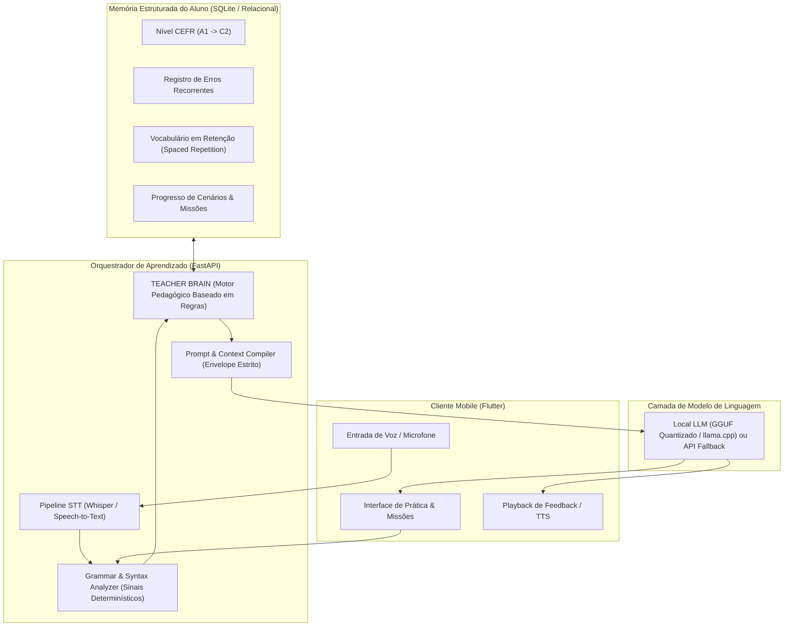

# English Tutor (AI Polyglot Tutor) — Arquitetura de Engenharia

> **Status:** Verified (System & AI Architecture)
> **Escopo:** Flutter Client, FastAPI Orchestration, Teacher Brain Determinístico & Pipeline de LLM
> **Última Atualização:** 2026-09-28

---

## 1. Visão Geral da Arquitetura

O **English Tutor (AI Polyglot Tutor)** é uma plataforma de aprendizado de idiomas desenhada para resolver a principal falha dos chatbots de IA convencionais: **fluência sem método pedagógico**.

A arquitetura adota o princípio de engenharia **"Rules Before Generation"** (Regras antes da Geração). O sistema desacopla a tomada de decisão pedagógica da geração textual: uma máquina de regras determinística (**Teacher Brain**) avalia o histórico do aluno e define a estratégia de ensino antes que o LLM (Local ou Remoto) componha a resposta.



---

## 2. O Motor Pedagógico: Teacher Brain

O **Teacher Brain** opera como uma máquina de estados finitos orientada a dados:

1. **Entrada do Aluno:** O aluno envia texto ou transcrição de áudio.
2. **Análise de Sinais Gramaticais:** Identificação determinística de tempo verbal, preposições incorretas ou vocabulário inadequado ao nível CEFR.
3. **Consulta de Memória:** O sistema verifica se o aluno já cometeu aquele erro específico anteriormente.
4. **Decisão Pedagógica (Action Decision):**
   * *Se o erro for novo e de nível acima do CEFR atual:* Ignora temporariamente para não sobrecarregar a cognição.
   * *Se o erro for recorrente e do nível atual:* Dispara ação `CORRECT_AND_PROMPT_PRACTICE`.
   * *Se a resposta for correta:* Dispara ação `ADVANCE_SCENARIO_WITH_NEW_VOCAB`.
5. **Geração Guiada (Envelope ao LLM):** O LLM recebe um prompt com restrições rígidas:
   ```text
   [SYSTEM INSTRUCTION - TEACHER BRAIN DIRECTIVE]
   Student Level: B1
   Pedagogical Move: Praise the attempt, explicitly highlight the preposition mistake 'in' -> 'at',
   and ask an open question requiring the use of the past continuous tense.
   Constraint: Do NOT provide the full translation; keep sentence length under 18 words.
   ```

---

## 3. Modelo de Privacidade e Execução Local

- **Modo Local:** Quando executado com modelos quantizados em formato GGUF (via llama.cpp/Ollama no hardware do usuário), nenhum áudio ou dado textual trafega por servidores de terceiros.
- **Isolamento de Áudio:** Os dados de voz são transcritos localmente via Whisper Tiny/Base no dispositivo, preservando a soberania e a privacidade biométrica do aluno.
