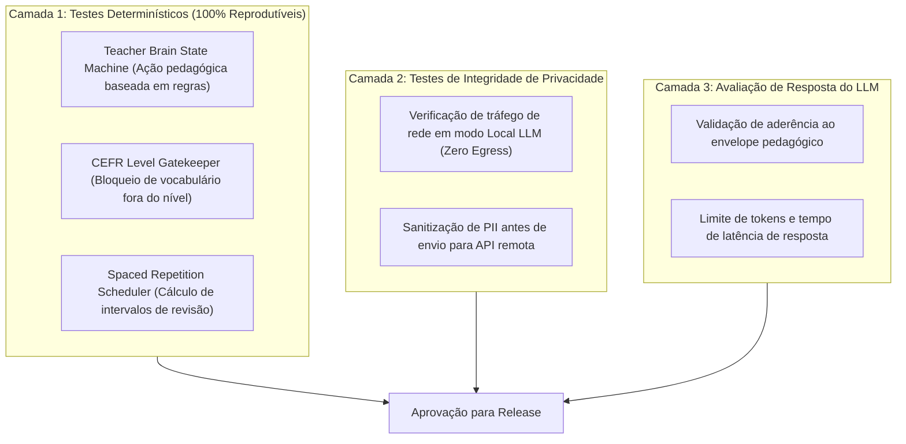

# English Tutor — Estratégia de Testes & Avaliação Pedagógica

> **Status:** Verified (Test Design & Verification)
> **Escopo:** Testes Determinísticos do Teacher Brain, Classificação CEFR e Integridade de Privacidade
> **Última Atualização:** 2026-09-28

---

## 1. Visão Geral da Suíte de Testes

Testar sistemas baseados em inteligência artificial requer uma distinção estrita entre **testes determinísticos de software** e **avaliação probabilística de geração**.

---

## 2. Cenários Críticos de Teste do Teacher Brain

### 2.1 Verificação de Decisão Pedagógica Determinística
* **Entrada de Teste:**
  * Aluno: Nível `A2`.
  * Histórico: 3 erros anteriores com o passado irregular de *to go* ("goed" em vez de "went").
  * Mensagem enviada pelo aluno: *"Yesterday I goed to the supermarket."*
* **Comportamento Esperado do Teacher Brain:**
  * A máquina de regras detecta o erro reincidente no banco relacional.
  * Dispara a diretiva `CORRECT_IRREGULAR_VERB` forçando o LLM a fornecer a correção imediata de *goed -> went* e solicitar uma frase adicional como treino.

### 2.2 Teste de Prevenção de Vazamento de Dados (Zero-Egress Test)
* **Objetivo:** Comprovar que em modo local o aplicativo não estabelece conexões HTTP externas.
* **Execução:** Mock do socket de rede em ambiente de teste com execução do pipeline completo de voz e inferência local; o teste falha se qualquer chamada DNS ou socket externo for detectada.
