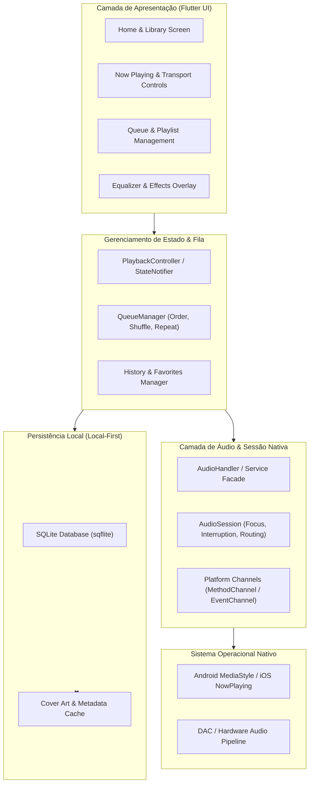

# Music Player — Arquitetura de Engenharia

> **Status:** Verified (Architecture & System Design)
> **Escopo:** Flutter Mobile Architecture, Audio Session, Queue Management & Local Persistence
> **Última Atualização:** 2026-09-28

---

## 1. Visão Geral da Arquitetura

O **Music Player** foi arquitetado como uma aplicação mobile local-first desenvolvida em **Flutter/Dart**, com foco no controle determinístico da sessão de áudio, resiliência do estado da fila e propriedade total dos dados pelo usuário.

Diferente de reprodutores focados em streaming que dependem de rede e servidores remotos, o sistema opera de forma soberana no dispositivo, utilizando o SQLite para persistência relacional de metadados e camadas de abstração para controle de hardware de áudio nativo (Android AudioTrack/OpenSL ES e iOS AVPlayer).

---

## 2. Componentes Principais do Sistema

### 2.1 AudioHandler & Ciclo de Vida em Background
- **Responsabilidade:** Gerenciar a reprodução de áudio contínua mesmo quando o aplicativo entra em background ou a tela é bloqueada.
- **Interrupções de Áudio:** Gerenciamento de eventos de foco (`AudioSession.duck`, `AudioSession.pause`), reagindo a chamadas telefônicas, alarmes e desconexão de fones de ouvido (unplugged event) pausando a reprodução imediatamente para evitar vazamento sonoro em alto-falantes.

### 2.2 QueueManager (Fila Determinística)
- **Persistência de Fila:** A fila de reprodução ativa é sincronizada com o banco local SQLite a cada transição de faixa, permitindo restauração exata da posição de milissegundos e lista de reprodução em caso de reinício do aplicativo pelo sistema operacional (Low Memory Killer).
- **Modos de Reprodução:** Implementação de algoritmos de Shuffle determinísticos (Fisher-Yates) com preservação da fila original para reversão imediata ao desativar o modo aleatório.

### 2.3 Camada de Persistência Local (SQLite)
- **Modelagem Relacional:**
  - `tracks`: URI local, título, artista, álbum, duração, bitrate, formato de codificação.
  - `playlists` & `playlist_tracks`: Relacionamento N:M para coleções personalizadas.
  - `playback_history`: Registro temporal de escuta para geração de lista de recentes e estatísticas locais.
  - `user_preferences`: Configurações de equalizador, ganho e modos de repetição.

---

## 3. Gestão de Recursos e Prevenção de Memory Leaks

No Flutter/Dart, gerenciar fluxos de áudio contínuos exige disciplina rigorosa no ciclo de vida de objetos:

1. **Cancelamento de Subscriptions:** Todas as `StreamSubscription` (posição de áudio, estado de buffer, listeners de volume) são canceladas explicitamente nos métodos `dispose()` dos controladores.
2. **Desalocação de Texturas de Capa:** Cache LRU em memória para capas de áudio (`ImageCache` limitado a 50MB) para evitar pressão na memória gráfica (OOM) em bibliotecas extensas com milhares de faixas.
3. **Desacoplamento de Notificações Nativas:** Liberação explícita dos canais de notificação e listeners de hardware quando o serviço é finalizado.
