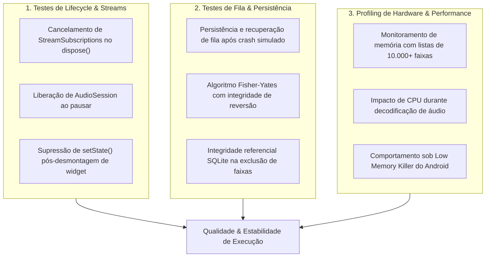

# Music Player — Estratégia de Testes & Ciclo de Vida

> **Status:** Verified (Test Design & Verification Plan)
> **Escopo:** Testes de Ciclo de Vida, Streams de Áudio, Persistência e Profiling
> **Última Atualização:** 2026-09-28

---

## 1. Visão Geral da Suíte de Testes

Aplicativos de áudio são suscetíveis a vazamentos de memória e erros de execução assíncrona devido à natureza contínua dos streams de posição e controle de hardware.

A estratégia de testes divide-se em 3 áreas essenciais:



---

## 2. Cenários Críticos de Verificação

### 2.1 Prevenção de Chamadas Pós-Dispose
* **Problema:** Listeners de posição de áudio (que emitem eventos a cada 200ms) podem disparar notificações após a tela do player ser fechada pelo usuário, causando exceções de `Unhandled Exception: setState() called after dispose()`.
* **Solução:** Padrão estruturado de cancelamento:
  ```dart
  @override
  void dispose() {
    _positionSubscription?.cancel();
    _playbackStateSubscription?.cancel();
    _playerController.dispose();
    super.dispose();
  }
  ```

### 2.2 Foco de Áudio e Interrupções
* **Cenário:** Recebimento de chamada telefônica enquanto a reprodução está ativa.
* **Comportamento Esperado:** O listener `audioSession.interruptionEventStream` deve pausar o reprodutor instantaneamente, salvar o estado e não retomar automaticamente a menos que sinalizado como seguro pelo sistema operacional.

### 2.3 Recuperação de Fila (Zero Data Loss)
* **Cenário:** O usuário está na faixa 47 de uma playlist de 200 músicas e o aplicativo é encerrado em background pelo gerenciador de memória do Android.
* **Comportamento Esperado:** Ao reabrir o app, o `QueueManager` carrega a última sessão a partir do SQLite, reidrata a lista na exata posição e aguarda o toque do usuário com o buffer pronto.
