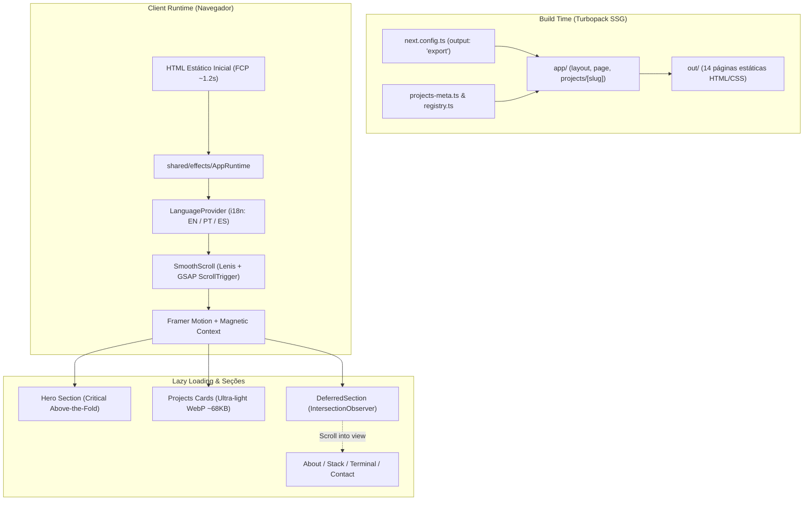

# Portfolio Nexus — Arquitetura de Engenharia

> **Status:** Verified
> **Escopo:** Frontend Core, Build Pipeline, Motion Runtime & i18n
> **Última Atualização:** 2026-09-28

---

## 1. Visão Geral do Sistema

O **Portfolio Nexus** é uma aplicação web de alta performance projetada para apresentar estudos de caso de engenharia de software com profundidade técnica, fidelidade visual e tempo de carregamento ultrarrápido.

A arquitetura adota o paradigma **Static Site Generation (SSG)** com **Next.js 16.2 (Turbopack)**, garantindo que 100% das páginas públicas sejam entregues como HTML estático puro, eliminando dependência de servidor Node.js em produção e permitindo hospedagem estática resiliente (Vercel / GitHub Pages).

---

## 2. Decisões Arquiteturais Fundamentais

### 2.1 Static Site Generation (SSG) & Static Export
- **Configuração:** `output: "export"`, `trailingSlash: true`, `images: { unoptimized: true }`.
- **Roteamento Dinâmico:** Todas as rotas de projetos (`/projects/[slug]`) são pré-computadas em tempo de build usando `generateStaticParams()`.
- **Benefício:** Zero latência de servidor (TTFB < 20ms em edge CDN), imunidade a falhas de backend e custo operacional zero.

### 2.2 Isolamento de Metadados e Code Splitting
- **Problema Anterior:** A página inicial importava `projectsList` de `registry.ts`, que referenciava dynamic imports de todos os 4 cases (Three.js, shaders, canvas, áudio). Isso inchava o bundle inicial com o grafo de dependências dos cases complexos.
- **Solução Arquitetural:** Separação estrita em duas camadas:
  1. `features/projects/projects-meta.ts`: Metadados leves (slug, título, thumbnail otimizada) consumidos pela Home.
  2. `features/projects/registry.ts`: Carregadores de componentes sob demanda (`loadComponent`) consumidos exclusivamente pela rota dinâmica `/projects/[slug]`.

### 2.3 Árvore de Runtime Estável (`AppRuntime`)
- **Problema de Reconciliação:** Alternar wrappers com condicionais no root desmontava a árvore React completa quando efeitos idle eram ativados, causando reflows e penalizando o LCP.
- **Solução Arquitetural:** O `AppRuntime` mantém a hierarquia de Providers (`LanguageProvider` → `MouseProvider` → `MagneticProvider` → `SmoothScroll` → `PageTransition`) permanentemente montada, ativando efeitos visuais granulares (como o cursor customizado) sem recriar componentes estruturais.

### 2.4 Internacionalização Client-Side Determinística
- **Estratégia:** Dicionários JSON tipados (`messages/en.json`, `messages/pt.json`, `messages/es.json`).
- **Alinhamento com SSG:** O HTML estático inicial é gerado no idioma padrão (`en`). O estado inicial do cliente é inicializado sincronicamente com `defaultLocale`, respeitando o `localStorage` caso o usuário já tenha feito uma seleção prévia explícita. Isso elimina substituições tardias de texto e incompatibilidades de hidratação.

---

## 3. Pipeline de Renderização e Dobra Crítica

| Camada | Mecanismo de Carregamento | Impacto de Performance |
| :--- | :--- | :--- |
| **Hero Section** | Renderização imediata no HTML inicial com animações CSS inline | LCP real registrado em **1.20s** |
| **Project Cards** | Componentes montados com miniaturas WebP de alta fidelidade | Imagens compactadas via Sharp (total ~68KB) |
| **Seções Abaixo da Dobra** | `DeferredSection` acionado por `IntersectionObserver` com `rootMargin: 400px` | Scripts de seções pesadas só baixam sob aproximação do scroll |
| **Efeitos Interativos** | Camada idle com `requestIdleCallback` (`HeroInteractiveLayer`) | Efeitos de mouse não bloqueiam a thread principal inicial |

---

## 4. Segurança e Acessibilidade

- **Sanitização de Contato:** Validação estrita de formulário e montagem de mailto com codificação de URI.
- **Redução de Movimento:** Hook `useReducedMotion()` e diretiva CSS `@media (prefers-reduced-motion: reduce)` integrados em todas as animações críticas do Hero, transições de página e scroll.
- **Navegação por Teclado:** Foco visível (`focus-visible:outline-none focus-visible:ring-2`) em todos os botões e links interativos.
- **Conformidade WCAG:** Contraste tipográfico auditado, tags semânticas completas (`h1`, `h2`, `article`, `aria-label`).
