# Portfolio Nexus — Matriz de Testes & Qualidade

> **Status:** Verified
> **Escopo:** Testes Unitários (Vitest), End-to-End (Playwright), Acessibilidade & Build Checks
> **Última Atualização:** 2026-10-10

---

## 1. Visão Geral da Estratégia de Testes

A suíte de testes do Portfolio Nexus foi desenhada para garantir que nenhum refatoramento visual ou de performance quebre a experiência do usuário ou os fluxos de contratação.

```mermaid
flowchart LR
    subgraph L1 ["Camada 1: Validação Estática"]
        Lint["ESLint (0 warnings, 0 errors)"]
        TSC["TypeScript --noEmit (Tipagem estrita)"]
    end

    subgraph L2 ["Camada 2: Testes Unitários & Hooks"]
        Vitest["Vitest (useReducedMotion, useTranslation, DirectContactForm)"]
    end

    subgraph L3 ["Camada 3: Build & Páginas"]
        Build["Next.js SSG Build (14 páginas estáticas geradas)"]
    end

    subgraph L4 ["Camada 4: Testes E2E (Playwright)"]
        E2E_Lang["Alternância de Idiomas (EN, PT, ES)"]
        E2E_Contact["Formulário & Mailto Link"]
        E2E_Nav["Navegação Home -> Case Study"]
        E2E_Summary["TL;DR dos 4 Cases"]
        E2E_Proof["Arquitetura, Trade-offs & Próximos Passos"]
        E2E_Resume["Preview & Download do Resume"]
    end

    L1 --> L2 --> L3 --> L4
```



---

## 2. Testes Unitários (Vitest)

Executados via `npm run test` com ambiente JSDOM.

| Arquivo de Teste | Suíte | Cenários Validados | Resultado |
| :--- | :--- | :--- | :--- |
| `shared/hooks/__tests__/useReducedMotion.test.ts` | `useReducedMotion` | Detecta `matchMedia` com `prefers-reduced-motion: reduce` e reage a mudanças dinâmicas do SO. | **2 / 2 aprovados** 🟢 |
| `shared/i18n/__tests__/useTranslation.test.tsx` | `useTranslation` | Renderiza traduções no idioma padrão, resolve chaves aninhadas e alterna dicionário sob demanda. | **3 / 3 aprovados** 🟢 |
| `features/home/components/__tests__/DirectContactForm.test.tsx` | `DirectContactForm` | Validação de campos obrigatórios, bloqueio de submissão inválida e montagem correta do link mailto. | **3 / 3 aprovados** 🟢 |

**Total Unitário:** 8 testes aprovados (100% de sucesso).

---

## 3. Testes End-to-End (Playwright)

Executados via `npm run test:e2e` sobre o servidor estático de produção (`out/`).

| Jornada de Usuário | Arquivo | O que é testado | Evidência de Sucesso |
| :--- | :--- | :--- | :--- |
| **Alternância Multilíngue** | `e2e/core-journeys.spec.ts` | Clica nos seletores de idioma (EN, PT, ES) no header fixo e valida que o título do Hero, badges e CTAs mudam instantaneamente. | **Passou (1.6s)** 🟢 |
| **Fluxo de Contato Direto** | `e2e/core-journeys.spec.ts` | Preenche os campos `#contact-name`, `#contact-subject`, `#contact-message` e valida que o atributo `href` do botão de envio é formatado com `mailto:vanderleividor1@gmail.com?subject=...&body=...`. | **Passou (2.1s)** 🟢 |
| **Navegação de Case Study** | `e2e/core-journeys.spec.ts` | Navega a partir do card "Music Player" na Home para `/projects/music-player/`, verificando a URL canônica e os elementos de arquitetura carregados. | **Passou (740ms)** 🟢 |
| **Leitura Rápida dos Cases** | `e2e/core-journeys.spec.ts` | Visita os quatro cases publicados e valida o bloco TL;DR com Role, Stack, Challenge, Key Decision, Evidence, Result e Status. | **Passou (2.2s)** 🟢 |
| **Prova Técnica dos Cases** | `e2e/core-journeys.spec.ts` | Percorre os quatro cases a partir do TL;DR, valida quatro etapas de arquitetura, três trade-offs e três próximos passos por projeto e confirma a localização EN/PT/ES. | **Passou (5.4s)** 🟢 |
| **Resume Localizado** | `e2e/core-journeys.spec.ts` | Valida preview em nova aba, download direto, feedback visual e os links com o `basePath` do GitHub Pages. | **Passou (742ms)** 🟢 |

**Total E2E:** 6 / 6 jornadas completas aprovadas contra o build de produção real no mesmo modo usado pelo CI.

---

## 4. Pipeline de Integração Local (Quality Gate)

O projeto exige aprovação de 100% dos passos antes de qualquer publicação:

```bash
npm run lint          # 0 erros, 0 avisos
npx tsc --noEmit      # 0 erros de tipagem
npm run test          # 8 testes unitários passando
npm run build         # 14 páginas estáticas geradas
npm run test:e2e      # 6 testes E2E executados sobre out/
```
