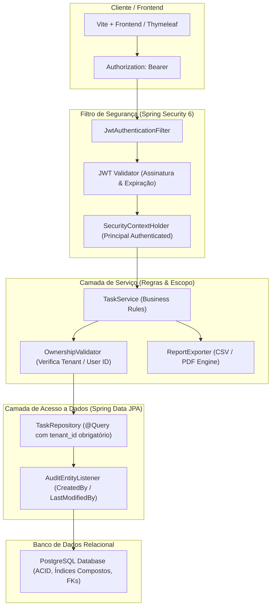

# SaaS Data Control (Task Manager Pro) — Arquitetura de Engenharia

> **Status:** Verified (System & Security Architecture)
> **Escopo:** Java 17, Spring Boot 3, Spring Security, Multi-tenant Data Scoping & PostgreSQL
> **Última Atualização:** 2026-09-28

---

## 1. Visão Geral da Arquitetura

O **SaaS Data Control (Task Manager Pro)** é uma plataforma corporativa de gerenciamento de tarefas estruturada em torno de isolamento estrito de dados, autorização defensiva em camadas de backend e consistência relacional.

A premissa arquitetural central é que a **interface nunca é a fronteira de segurança**. Toda regra de negócio, escopo de tenant e autorização de acesso a entidades é verificada no nível do serviço Java e validada por consultas JPA com escopo forçado.



---

## 2. Princípios de Segurança e Isolamento de Dados

### 2.1 Prevenção de IDOR (Insecure Direct Object Reference)
- **Vulnerabilidade Comum:** APIs que recebem `/api/tasks/{id}` e buscam `taskRepository.findById(id)` sem checar a qual usuário ou tenant aquela tarefa pertence. Um usuário mal-intencionado pode alterar o `{id}` e acessar dados de outras empresas.
- **Implementação Defensiva no Task Manager Pro:**
  ```java
  @Transactional(readOnly = true)
  public TaskResponseDTO getTaskById(Long taskId, UserPrincipal currentUser) {
      return taskRepository.findByIdAndTenantId(taskId, currentUser.getTenantId())
          .map(taskMapper::toDto)
          .orElseThrow(() -> new ResourceNotFoundException("Task not found with id: " + taskId));
  }
  ```
  O ID do tenant é extraído diretamente do token de autenticação assinado e criptograficamente verificado, nunca de parâmetros fornecidos pelo cliente.

### 2.2 Ciclo de Vida da Sessão: JWT + Refresh Token Rotation
- **Access Token:** JWT de vida curta (15 minutos) assinado com HMAC-SHA256, contendo `userId`, `tenantId` e `roles`.
- **Refresh Token:** Token opaco armazenado em banco de dados relacional com data de expiração (7 dias) e estado de revogação.
- **Rotação:** A cada renovação de sessão, o refresh token anterior é imediatamente invalidado e um novo par é gerado. Se um token revogado for reutilizado, a sessão inteira daquele usuário é anulada por suspeita de interceptação.

---

## 3. Modelo de Dados e Índices Estruturais

O esquema relacional do PostgreSQL foi projetado com chaves estrangeiras rígidas e índices compostos focados em alta taxa de leitura por tenant:

```sql
CREATE TABLE tasks (
    id BIGSERIAL PRIMARY KEY,
    tenant_id BIGINT NOT NULL,
    user_id BIGINT NOT NULL,
    title VARCHAR(255) NOT NULL,
    description TEXT,
    status VARCHAR(50) NOT NULL,
    priority VARCHAR(50) NOT NULL,
    due_date TIMESTAMP WITH TIME ZONE,
    created_at TIMESTAMP WITH TIME ZONE DEFAULT CURRENT_TIMESTAMP,
    updated_at TIMESTAMP WITH TIME ZONE DEFAULT CURRENT_TIMESTAMP,
    CONSTRAINT fk_tasks_tenant FOREIGN KEY (tenant_id) REFERENCES tenants(id) ON DELETE CASCADE,
    CONSTRAINT fk_tasks_user FOREIGN KEY (user_id) REFERENCES users(id) ON DELETE RESTRICT
);

-- Índice composto para consultas com escopo de tenant e ordenação por prioridade
CREATE INDEX idx_tasks_tenant_status ON tasks(tenant_id, status);
CREATE INDEX idx_tasks_tenant_due_date ON tasks(tenant_id, due_date);
```
