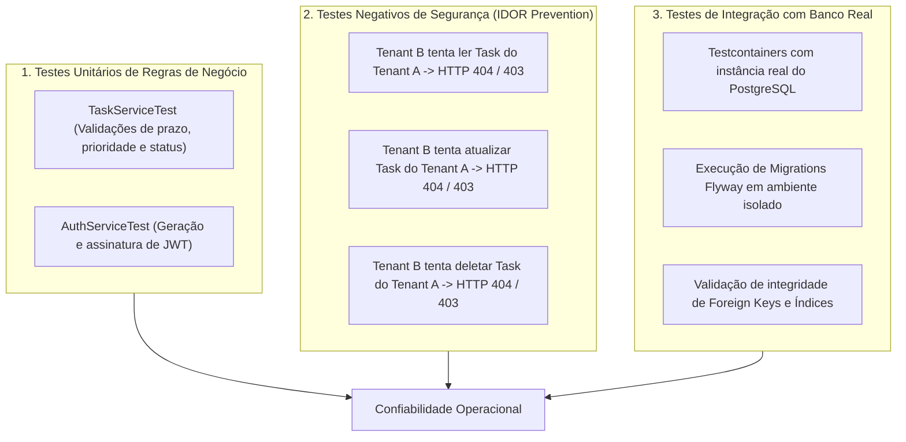

# SaaS Data Control — Estratégia de Testes & Segurança

> **Status:** Verified (Test Design & Security Verification)
> **Escopo:** Testes de Segurança (IDOR), Isolamento Multi-tenant e Integração com Testcontainers
> **Última Atualização:** 2026-09-28

---

## 1. Visão Geral da Estratégia de Testes

A segurança de uma aplicação SaaS depende da capacidade de provar que usuários maliciosos não conseguem ler nem modificar recursos de outras organizações.



---

## 2. Padrão de Teste Negativo de Acesso Cruzado (IDOR)

O teste abaixo exemplifica a metodologia aplicada para comprovar a eficácia do isolamento de dados:

```java
@Test
@DisplayName("Deve retornar 404 quando Usuário do Tenant B tentar acessar Task pertencente ao Tenant A")
void shouldReturn404WhenAccessingTaskFromAnotherTenant() {
    // 1. Arrange: Cria uma task vinculada ao Tenant A
    Task taskTenantA = taskRepository.save(new Task("Relatório Financeiro", tenantA.getId(), userTenantA.getId()));

    // 2. Act: Autentica como Usuário do Tenant B e tenta buscar a task do Tenant A
    HttpHeaders headersTenantB = createAuthHeadersFor(userTenantB);
    ResponseEntity<String> response = restTemplate.exchange(
        "/api/tasks/" + taskTenantA.getId(),
        HttpMethod.GET,
        new HttpEntity<>(headersTenantB),
        String.class
    );

    // 3. Assert: O sistema não deve revelar sequer a existência da tarefa
    assertThat(response.getStatusCode()).isEqualTo(HttpStatus.NOT_FOUND);
}
```

*Por que retornar `404 Not Found` em vez de `403 Forbidden`?*
Para evitar vazamento de metadados (**Enumeration Attack**). Retornar 403 confirma para o invasor que a entidade existe. Retornar 404 oculta a existência do recurso fora do tenant autorizado.

---

## 3. Integração com Testcontainers

Para evitar diferenças comportamentais entre bancos em memória (H2) e o banco de produção (PostgreSQL com suporte nativo a tipos JSONB, funções de timezone e índices parciais), os testes de integração sobem contêineres Docker efêmeros do PostgreSQL real via biblioteca Testcontainers no pipeline de CI.
